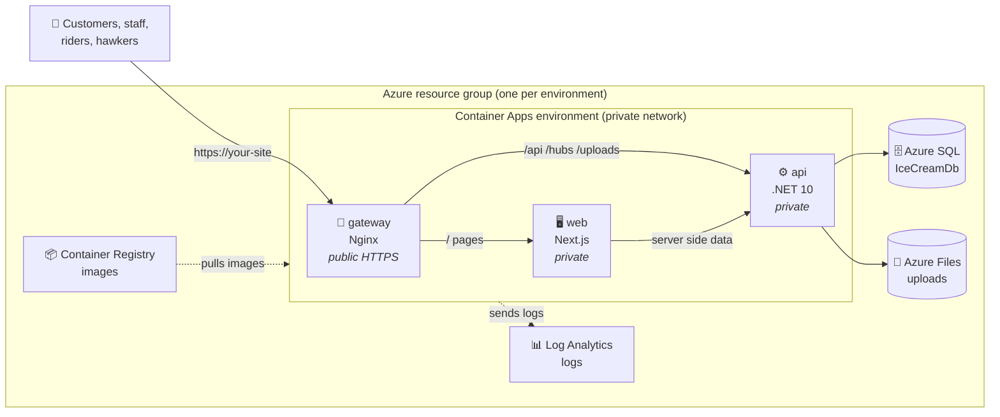
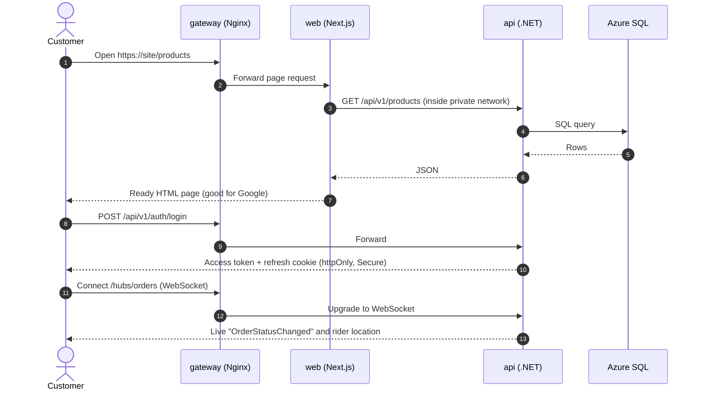
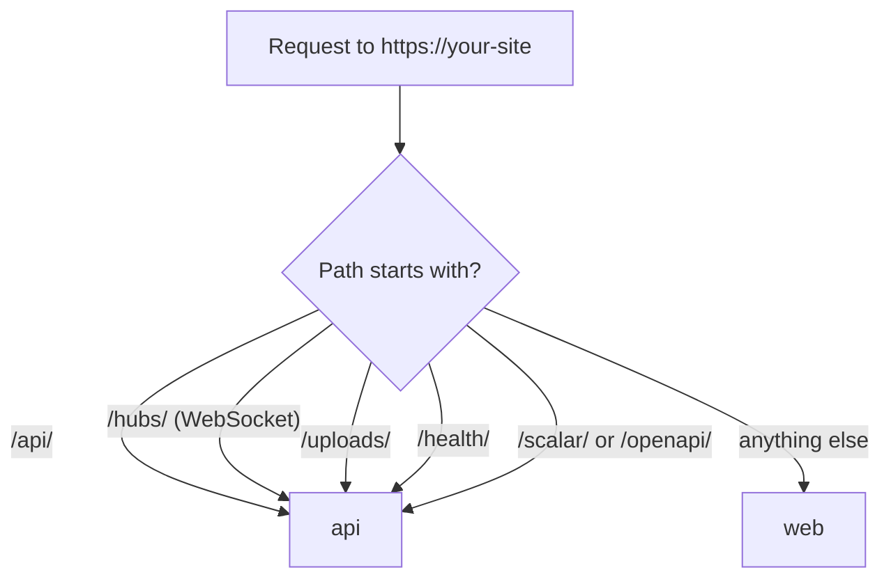
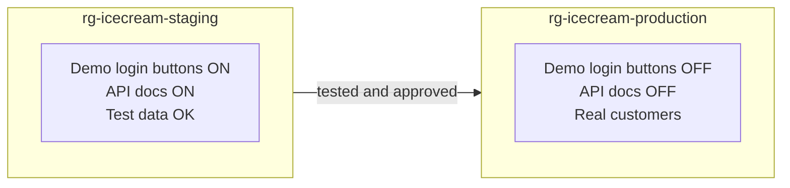
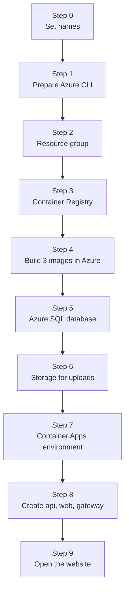
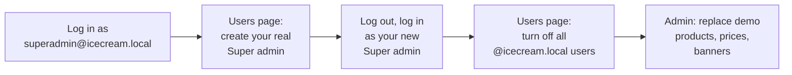
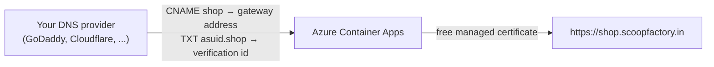
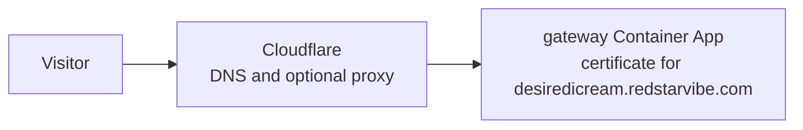
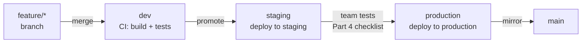
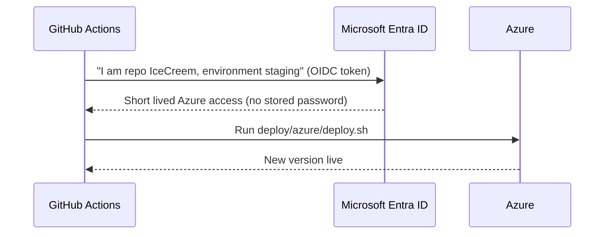

# Deploy to Azure: Step by Step Guide

This guide puts the Ice Cream Factory platform live on Microsoft Azure.
It is written for everyone: you do not need to know Azure or Docker before you start.

You can deploy in two ways:

| Way | Best for | Time |
|---|---|---|
| **A. One script** | Getting live fast | About 20 minutes |
| **B. Step by step** | Learning what each part does | About 45 minutes |

Both ways create exactly the same setup. Read Part 1 first, then pick A or B.

---

## Contents

1. [Part 1: Understand the setup](#part-1-understand-the-setup)
2. [Part 2: Before you start](#part-2-before-you-start)
3. [Part 3A: Deploy with one script](#part-3a-deploy-with-one-script)
4. [Part 3B: Deploy step by step](#part-3b-deploy-step-by-step)
5. [Part 4: Check that everything works](#part-4-check-that-everything-works)
6. [Part 5: Secure the live site](#part-5-secure-the-live-site)
7. [Part 6: Your own domain and HTTPS](#part-6-your-own-domain-and-https)
8. [Part 7: Release a new version](#part-7-release-a-new-version)
9. [Part 8: Automatic deploys from GitHub](#part-8-automatic-deploys-from-github)
10. [Part 9: Daily operations](#part-9-daily-operations)
11. [Part 10: Troubleshooting](#part-10-troubleshooting)
12. [Part 11: Delete everything](#part-11-delete-everything)

---

## Part 1: Understand the setup

### 1.1 The big picture



**In plain words:**

- People only ever talk to the **gateway**. It is the front door with HTTPS.
- The gateway sends page requests to **web** and data requests to **api**.
- **web** and **api** are private. Nobody on the internet can reach them directly.
- **api** stores data in **Azure SQL** and uploaded product photos in **Azure Files**.
- The **Container Registry** keeps the built app images. Azure builds them for you.
- **Log Analytics** collects logs from every app, so you can see errors.

### 1.2 What each Azure service does

| Service | Our name | What it does | Why we chose it |
|---|---|---|---|
| Resource group | `rg-icecream-staging` | A folder that holds everything for one environment | Delete the folder and everything inside goes away |
| Container Registry | `icecream...acr` | Builds and stores Docker images | Builds in the cloud, so you do not need Docker on your PC |
| Container Apps environment | `icecream-staging-env` | A private network where our apps run | Managed HTTPS, auto restart, scaling, WebSockets for live tracking |
| Container App `gateway` | `gateway` | Nginx, the only public app | One web address for pages, API and live updates |
| Container App `web` | `web` | The Next.js website and admin panel | Scales from 1 to 3 copies with traffic |
| Container App `api` | `api` | The .NET API, SignalR live hub | Runs database migrations on start |
| Azure SQL Database | `IceCreamDb` | Stores all business data | Managed backups, serverless (pauses when idle to save money) |
| Storage account + file share | `uploads` | Product images uploaded by admins | Files survive app restarts and new versions |
| Log Analytics | created automatically | Logs and metrics | Search errors in one place |

### 1.3 How one request travels



### 1.4 Routing rules in the gateway



The rules live in [`deploy/azure/nginx.conf`](../deploy/azure/nginx.conf).
One address for everything means the login cookie works without any CORS setup.

### 1.5 Staging and production

You create the same setup twice, in two resource groups. They never share data.



| Setting | Staging | Production |
|---|---|---|
| Demo login buttons | On | Off |
| API docs at `/scalar/v1` | On | Off |
| Who uses it | Your team, for testing | Real customers |

### 1.6 Monthly cost (rough idea)

Prices change and differ by region. Always check the
[Azure pricing calculator](https://azure.microsoft.com/pricing/calculator/). For one small environment:

| Item | Rough cost per month |
|---|---|
| Container Apps (3 small apps, low traffic) | Low. A monthly free grant covers much of light use |
| Azure SQL serverless (pauses when idle) | Low for light use, grows with active hours |
| Container Registry Basic | About 5 USD |
| Storage (5 GB file share) | Under 1 USD |
| Log Analytics | Pay per GB of logs, small for light use |

> **Tip:** Delete the staging resource group when you are not testing (Part 11). You can recreate it any time with the script.

---

## Part 2: Before you start

### 2.1 What you need

| Need | How to get it |
|---|---|
| An Azure account with a subscription | Sign up at https://azure.microsoft.com/free |
| Owner or Contributor role on the subscription | Ask your Azure admin if you use a company account |
| This repository | `https://github.com/aarvitechai/IceCreem` |
| A terminal with Azure CLI | Easiest: **Azure Cloud Shell** (nothing to install) |

### 2.2 Open Azure Cloud Shell

1. Go to https://portal.azure.com and sign in.
2. Click the **Cloud Shell** icon `>_` at the top bar.
3. Choose **Bash**.
4. If asked for storage, accept the default.

Cloud Shell already has `az`, `git`, `openssl` and `envsubst`. You are signed in automatically.

> Prefer your own PC? Install [Azure CLI](https://learn.microsoft.com/cli/azure/install-azure-cli), then run `az login`.
> On Windows, run the commands in **Git Bash**, not PowerShell.

### 2.3 Pick the right subscription

```bash
az account list -o table                  # see your subscriptions
az account set --subscription "<name or id>"
az account show --query name -o tsv       # confirm
```

### 2.4 Get the code

```bash
git clone https://github.com/aarvitechai/IceCreem.git
cd IceCreem
git checkout staging          # or production for the live site
```

### 2.5 Create your secrets

You need three secret values. Keep them in a password manager. **Never put them in Git.**

| Secret | Rules | Used for |
|---|---|---|
| `SQL_ADMIN_PASSWORD` | 12+ characters, upper, lower, number, symbol. No quotes `"` `'` and no backslash | Database admin login |
| `JWT_KEY` | 32+ random characters | Signs login tokens |
| `SEED_PASSWORD` | 8+ characters, one capital letter, one number | First password of the starter users |

Generate strong values in Cloud Shell:

```bash
export SQL_ADMIN_PASSWORD="Ic$(openssl rand -hex 8)#A9"
export JWT_KEY="$(openssl rand -base64 48)"
export SEED_PASSWORD="Start$(openssl rand -hex 4)9"

# Show them once so you can save them in your password manager
echo "SQL:  $SQL_ADMIN_PASSWORD"
echo "JWT:  $JWT_KEY"
echo "SEED: $SEED_PASSWORD"
```

> **Use different secrets for staging and production.**

---

## Part 3A: Deploy with one script

The script [`deploy/azure/deploy.sh`](../deploy/azure/deploy.sh) does all the steps of Part 3B for you.
It is safe to run again later: it creates what is missing and updates what exists.

```bash
# From the repository root, with the 3 secrets exported (Part 2.5)
APP_ENV=staging bash deploy/azure/deploy.sh
```

For production:

```bash
git checkout production
# export production secrets first (different from staging)
APP_ENV=production bash deploy/azure/deploy.sh
```

Optional settings:

| Variable | Default | Example |
|---|---|---|
| `APP_ENV` | `staging` | `production` |
| `LOCATION` | `centralindia` | `southindia`, `westeurope`, `eastus` |
| `PREFIX` | `icecream` | `scoop` (lowercase letters only) |
| `TAG` | current Git commit | `v1.0.0` |

At the end you will see:

```
Website:  https://gateway.<random>.centralindia.azurecontainerapps.io
Admin:    https://gateway.<random>.centralindia.azurecontainerapps.io/admin
API docs: https://gateway.<random>.centralindia.azurecontainerapps.io/scalar/v1   (staging only)
Health:   https://gateway.<random>.centralindia.azurecontainerapps.io/health/ready
```

Wait 1 to 2 minutes on the first run (database setup), then go to [Part 4](#part-4-check-that-everything-works).

---

## Part 3B: Deploy step by step

Same result as the script, one piece at a time, so you understand each part.



### Step 0: Set names

Some Azure names must be unique in the whole world. We add a short code made from your subscription id.

```bash
APP_ENV=staging                   # or production
LOCATION=centralindia
PREFIX=icecream
TAG=$(git rev-parse --short HEAD)

SUFFIX=$(az account show --query id -o tsv | md5sum | cut -c1-5)
SHORT_ENV=${APP_ENV:0:4}
RG=rg-$PREFIX-$APP_ENV
ACR=${PREFIX}${SHORT_ENV}${SUFFIX}acr
SQL_SERVER=$PREFIX-$SHORT_ENV-$SUFFIX-sql
SQL_DB=IceCreamDb
SQL_ADMIN=icecreamadmin
STORAGE=${PREFIX}${SHORT_ENV}${SUFFIX}st
ENV_NAME=$PREFIX-$APP_ENV-env

if [ "$APP_ENV" = staging ]; then SHOW_DEMO_LOGINS=true; API_DOCS=true; else SHOW_DEMO_LOGINS=false; API_DOCS=false; fi
```

> If Cloud Shell restarts, run Step 0 and Part 2.5 again. Variables are lost when the session ends.

### Step 1: Prepare Azure CLI

Adds the Container Apps commands and turns on the services we use (one time per subscription).

```bash
az extension add --name containerapp --upgrade
az provider register -n Microsoft.App --wait
az provider register -n Microsoft.OperationalInsights --wait
```

### Step 2: Create the resource group

The folder for everything in this environment.

```bash
az group create -n $RG -l $LOCATION
```

### Step 3: Create the Container Registry

A private store for our app images.

```bash
az acr create -n $ACR -g $RG --sku Basic --admin-enabled true
ACR_SERVER=$(az acr show -n $ACR --query loginServer -o tsv)
ACR_USER=$(az acr credential show -n $ACR --query username -o tsv)
ACR_PASSWORD=$(az acr credential show -n $ACR --query "passwords[0].value" -o tsv)
```

### Step 4: Build the three images in Azure

`az acr build` uploads the source code and builds it in Azure. No Docker on your PC.

```bash
# API (.NET)
az acr build -r $ACR -t icecream-api:$TAG backend

# Website (Next.js). It reaches the API by its private name "api".
az acr build -r $ACR -t icecream-web:$TAG \
  --build-arg API_INTERNAL_URL=http://api \
  --build-arg NEXT_PUBLIC_SHOW_DEMO_LOGINS=$SHOW_DEMO_LOGINS \
  frontend

# Gateway (Nginx with our routing rules)
az acr build -r $ACR -t icecream-gateway:$TAG -f deploy/azure/Dockerfile.gateway deploy/azure
```

Each build takes 2 to 6 minutes. Check the result:

```bash
az acr repository list -n $ACR -o table
```

### Step 5: Create the Azure SQL database

```bash
az sql server create -n $SQL_SERVER -g $RG -l $LOCATION \
  --admin-user $SQL_ADMIN --admin-password "$SQL_ADMIN_PASSWORD"

az sql db create -n $SQL_DB -s $SQL_SERVER -g $RG \
  --edition GeneralPurpose --compute-model Serverless --family Gen5 --capacity 1 \
  --auto-pause-delay 60 --backup-storage-redundancy Local

# 0.0.0.0 means "allow Azure services", so our apps can connect
az sql server firewall-rule create -s $SQL_SERVER -g $RG -n AllowAzureServices \
  --start-ip-address 0.0.0.0 --end-ip-address 0.0.0.0

DB_CONNECTION="Server=tcp:$SQL_SERVER.database.windows.net,1433;Initial Catalog=$SQL_DB;User ID=$SQL_ADMIN;Password=$SQL_ADMIN_PASSWORD;Encrypt=True;TrustServerCertificate=False;Connection Timeout=60;"
```

> **Serverless** pauses the database after 60 idle minutes to save money.
> The first request after a pause takes about a minute while it wakes up. The API retries automatically.
> For production with steady traffic you can set `--auto-pause-delay -1` (never pause).

You do **not** create tables. The API creates and updates them on start (EF Core migrations).

### Step 6: Create storage for uploaded images

Files inside a container are lost when it restarts. A file share keeps them safe.

```bash
az storage account create -n $STORAGE -g $RG -l $LOCATION --sku Standard_LRS --kind StorageV2 --min-tls-version TLS1_2
STORAGE_KEY=$(az storage account keys list -n $STORAGE -g $RG --query "[0].value" -o tsv)
az storage share-rm create --storage-account $STORAGE -g $RG -n uploads --quota 5
```

### Step 7: Create the Container Apps environment

The private network for our three apps. It also creates a Log Analytics workspace.

```bash
az containerapp env create -n $ENV_NAME -g $RG -l $LOCATION

# Make the file share available to apps in this environment
az containerapp env storage set -n $ENV_NAME -g $RG --storage-name uploads \
  --azure-file-account-name $STORAGE --azure-file-account-key $STORAGE_KEY \
  --azure-file-share-name uploads --access-mode ReadWrite

ENV_ID=$(az containerapp env show -n $ENV_NAME -g $RG --query id -o tsv)
```

### Step 8: Create the three apps

#### 8.1 api

The API is defined in [`deploy/azure/api.yaml`](../deploy/azure/api.yaml) because it needs the uploads folder.
`envsubst` fills the `${...}` values into a temporary file, which we delete right after.

```bash
export LOCATION ENV_ID ACR_SERVER ACR_USER ACR_PASSWORD DB_CONNECTION JWT_KEY SEED_PASSWORD TAG API_DOCS
envsubst '$LOCATION $ENV_ID $ACR_SERVER $ACR_USER $ACR_PASSWORD $DB_CONNECTION $JWT_KEY $SEED_PASSWORD $TAG $API_DOCS' \
  < deploy/azure/api.yaml > /tmp/api.yaml

az containerapp create -n api -g $RG --yaml /tmp/api.yaml
rm /tmp/api.yaml
```

What the YAML sets up:

| Setting | Value | Why |
|---|---|---|
| Ingress | internal, port 8080 | Only the gateway and web can reach it |
| Secrets | DB connection, JWT key, seed password | Stored encrypted by Azure, never in the image |
| Health probes | `/health/live` and `/health/ready` | Azure restarts the app if it stops answering |
| Volume | file share at `/app/wwwroot/uploads` | Uploaded images survive restarts |
| Replicas | exactly 1 | Live tracking keeps connections in memory (see Part 9.4) |

#### 8.2 web

```bash
az containerapp create -n web -g $RG --environment $ENV_NAME \
  --image $ACR_SERVER/icecream-web:$TAG \
  --registry-server $ACR_SERVER --registry-username $ACR_USER --registry-password $ACR_PASSWORD \
  --target-port 3000 --ingress internal \
  --min-replicas 1 --max-replicas 3 --cpu 0.5 --memory 1.0Gi \
  --env-vars API_INTERNAL_URL=http://api

az containerapp ingress update -n web -g $RG --allow-insecure
```

`--allow-insecure` lets the gateway talk to web over plain HTTP **inside** the private network.
Visitors still use HTTPS.

#### 8.3 gateway

The only public app.

```bash
az containerapp create -n gateway -g $RG --environment $ENV_NAME \
  --image $ACR_SERVER/icecream-gateway:$TAG \
  --registry-server $ACR_SERVER --registry-username $ACR_USER --registry-password $ACR_PASSWORD \
  --target-port 80 --ingress external \
  --min-replicas 1 --max-replicas 2 --cpu 0.5 --memory 1.0Gi
```

### Step 9: Open the website

```bash
URL=$(az containerapp show -n gateway -g $RG --query properties.configuration.ingress.fqdn -o tsv)
echo "https://$URL"
```

---

## Part 4: Check that everything works

### 4.1 Quick health check

```bash
curl -s https://$URL/health/ready        # expect: Healthy
curl -s https://$URL/api/v1/categories | head -c 200
```

### 4.2 Test checklist

Starter users are created on the first start. Their password is your `SEED_PASSWORD`.

| # | Test | Login | Expected |
|---|---|---|---|
| 1 | Home page loads with carousel and products | none | Pictures and prices show |
| 2 | Add 2 items to cart, checkout as guest | none | Order number like `ICE-2026-000001` |
| 3 | Open the tracking page from the success screen | none | Status "Placed", Live badge |
| 4 | Admin: Orders, open the order, Mark confirmed, Mark packed | admin@icecream.local | Tracking page updates by itself |
| 5 | Admin: assign rider "Suresh Delivery" | admin@icecream.local | OTP appears on the tracking page |
| 6 | Delivery app: Picked up, enter OTP, Mark delivered | delivery@icecream.local | Status Delivered, payment Paid |
| 7 | Admin: Products, edit a product, upload an image | admin@icecream.local | Image shows in the shop |
| 8 | Restart api (Part 9.2), reload the product | any | Image is still there |
| 9 | Wedding: book a date 10+ days ahead | customer@icecream.local | Booking number like `BKG-2026-000001` |
| 10 | Dashboard shows today's revenue | admin@icecream.local | Numbers and charts |

All starter users:

| Role | Login |
|---|---|
| Super admin | superadmin@icecream.local |
| Admin | admin@icecream.local |
| Staff | staff@icecream.local |
| Delivery | delivery@icecream.local |
| Hawker | hawker@icecream.local |
| Customer | customer@icecream.local |

---

## Part 5: Secure the live site

Do this **once, right after the first production deploy**.



Checklist:

- [ ] Real super admin created with your own email and a strong password.
- [ ] All `@icecream.local` starter users switched off in **Users** (they cannot log in anymore).
- [ ] Demo products, banners and coupons replaced with real ones.
- [ ] Secrets saved in a password manager and different from staging.
- [ ] Production was deployed with `APP_ENV=production` (demo buttons and API docs off).
- [ ] Your own domain added (Part 6).

Good to know about built in protection:

| Protection | Where |
|---|---|
| HTTPS with a managed certificate | Azure ingress |
| API and web not reachable from the internet | Internal ingress |
| Secrets encrypted, not in images or Git | Container App secrets |
| Login lock after 5 wrong passwords, rate limits | API |
| Refresh token in httpOnly Secure cookie, rotated, reuse detected | API |
| Daily database backups, 7 days point in time restore | Azure SQL (automatic) |

**Stronger options for later:**

| Upgrade | Benefit |
|---|---|
| Azure Key Vault for secrets | Central secret storage and rotation |
| Managed identity for the registry and SQL | No passwords at all for service to service |
| Private endpoint for SQL | Database not exposed even to other Azure customers |
| Azure Front Door with WAF | Blocks common attacks, global CDN |

---

## Part 6: Your own domain and HTTPS

Example: you own `scoopfactory.in` and want `shop.scoopfactory.in`.



1. Get the two values Azure needs:

   ```bash
   az containerapp show -n gateway -g $RG --query properties.configuration.ingress.fqdn -o tsv
   az containerapp env show -n $ENV_NAME -g $RG --query properties.customDomainConfiguration.customDomainVerificationId -o tsv
   ```

2. At your DNS provider add two records:

   | Type | Name | Value |
   |---|---|---|
   | CNAME | `shop` | the gateway address from step 1 |
   | TXT | `asuid.shop` | the verification id from step 1 |

3. Wait 5 to 30 minutes for DNS, then connect the domain and get a free certificate:

   ```bash
   az containerapp hostname add -n gateway -g $RG --hostname shop.scoopfactory.in
   az containerapp hostname bind -n gateway -g $RG --hostname shop.scoopfactory.in \
     --environment $ENV_NAME --validation-method CNAME
   ```

4. Open `https://shop.scoopfactory.in`. The certificate renews automatically.

### 6.1 When your DNS is on Cloudflare

Example used by this project: `desiredicream.redstarvibe.com`, with `redstarvibe.com` managed in Cloudflare.



1. In Cloudflare, open **redstarvibe.com → DNS → Records** and add:

   | Type | Name | Target | Proxy status |
   |---|---|---|---|
   | CNAME | `desiredicream` | gateway address from step 1 above | **DNS only** (grey cloud) |
   | TXT | `asuid.desiredicream` | verification id from step 1 above | not applicable |

   Keep the grey cloud for now. Azure must reach the site directly to issue the certificate.

2. Bind the domain:

   ```bash
   az containerapp hostname add -n gateway -g $RG --hostname desiredicream.redstarvibe.com
   az containerapp hostname bind -n gateway -g $RG --hostname desiredicream.redstarvibe.com \
     --environment $ENV_NAME --validation-method CNAME
   ```

3. Open `https://desiredicream.redstarvibe.com` and check it loads with a valid lock icon.

4. Optional, for Cloudflare caching and protection: switch the record to **Proxied** (orange cloud),
   then set **SSL/TLS → Overview → Full (strict)**. Never use "Flexible", it causes redirect loops.
   Under **Network**, keep **WebSockets** on, so live order tracking works.

> **Moving from a Cloudflare Tunnel to Azure?** Delete the tunnel's CNAME record for `desiredicream`
> first, then add the records above. The address stays the same for your customers.

---

## Part 7: Release a new version

The normal flow, from code change to live site:



**Manual release** (after merging your change into the branch):

```bash
git checkout staging && git pull
APP_ENV=staging bash deploy/azure/deploy.sh      # same secrets as before
```

The script builds new images tagged with the Git commit and updates the three apps.
Azure starts the new version, checks health, then switches traffic. No downtime for web and gateway.
The API has one replica, so expect a few seconds of pause while it restarts.

Database changes ship inside the API. New EF Core migrations run automatically on start.

### Roll back to an earlier version

Every image is kept with its commit tag.

```bash
az acr repository show-tags -n $ACR --repository icecream-api -o table    # find the old tag

OLD=abc1234
az containerapp update -n api -g $RG --image $ACR_SERVER/icecream-api:$OLD
az containerapp update -n web -g $RG --image $ACR_SERVER/icecream-web:$OLD
az containerapp update -n gateway -g $RG --image $ACR_SERVER/icecream-gateway:$OLD
```

> Rolling back code does not undo a database migration. Before a release that changes the database,
> check Part 9.3 so you know how to restore the database.

---

## Part 8: Automatic deploys from GitHub

The workflow [`.github/workflows/deploy-azure.yml`](../.github/workflows/deploy-azure.yml) runs the same script from GitHub:

| Event | Result |
|---|---|
| Push to `staging` | Deploys staging |
| Push to `production` | Deploys production (you can require an approval) |
| Actions tab, "Run workflow" | Deploys the environment you pick |

It stays **off** until you finish the steps below.



### 8.1 Create an identity for GitHub (one time)

Run in Cloud Shell. Replace the repo name if you forked it.

```bash
REPO=aarvitechai/IceCreem
SUB_ID=$(az account show --query id -o tsv)
TENANT_ID=$(az account show --query tenantId -o tsv)

APP_ID=$(az ad app create --display-name icecream-github-deploy --query appId -o tsv)
az ad sp create --id $APP_ID
az role assignment create --assignee $APP_ID --role Contributor --scope /subscriptions/$SUB_ID

for ENV in staging production; do
  az ad app federated-credential create --id $APP_ID --parameters "{
    \"name\": \"github-$ENV\",
    \"issuer\": \"https://token.actions.githubusercontent.com\",
    \"subject\": \"repo:$REPO:environment:$ENV\",
    \"audiences\": [\"api://AzureADTokenExchange\"]
  }"
done

echo "AZURE_CLIENT_ID=$APP_ID"
echo "AZURE_TENANT_ID=$TENANT_ID"
echo "AZURE_SUBSCRIPTION_ID=$SUB_ID"
```

### 8.2 Add settings in GitHub

In the repository: **Settings → Environments**, create `staging` and `production`.
For each environment add these **secrets**:

| Secret | Value |
|---|---|
| `AZURE_CLIENT_ID` | from 8.1 |
| `AZURE_TENANT_ID` | from 8.1 |
| `AZURE_SUBSCRIPTION_ID` | from 8.1 |
| `SQL_ADMIN_PASSWORD` | same value you used for that environment |
| `JWT_KEY` | same value you used for that environment |
| `SEED_PASSWORD` | same value you used for that environment |

Then **Settings → Secrets and variables → Actions → Variables**, add:

| Variable | Value |
|---|---|
| `AZURE_DEPLOY_ENABLED` | `true` |
| `AZURE_LOCATION` | your region, for example `centralindia` (optional) |

For production approvals: **Settings → Environments → production → Required reviewers**, add yourself.

> Keep the same `SQL_ADMIN_PASSWORD` and `JWT_KEY` between runs. Changing `JWT_KEY` logs everyone out.
> Changing `SQL_ADMIN_PASSWORD` here does not change the database password itself.

---

## Part 9: Daily operations

### 9.1 See logs

```bash
az containerapp logs show -n api -g $RG --follow          # live API logs
az containerapp logs show -n web -g $RG --tail 100
az containerapp logs show -n gateway -g $RG --tail 100
```

In the portal: open the Container App → **Monitoring → Log stream**, or **Logs** to search history.

### 9.2 Restart an app

```bash
REV=$(az containerapp revision list -n api -g $RG --query "[0].name" -o tsv)
az containerapp revision restart -n api -g $RG --revision $REV
```

### 9.3 Database backups and restore

Azure SQL takes backups automatically and keeps 7 days by default.
To restore to a point in time, create a copy, check it, then point the API to it:

```bash
az sql db restore -g $RG -s $SQL_SERVER -n $SQL_DB --dest-name IceCreamDb-restored \
  --time "2026-11-20T10:00:00Z"
```

Then update the `db-connection` secret with `Initial Catalog=IceCreamDb-restored` and restart the api:

```bash
az containerapp secret set -n api -g $RG --secrets "db-connection=<new connection string>"
```

To connect with SQL Server Management Studio or Azure Data Studio from your PC,
add your IP first:

```bash
MYIP=$(curl -s https://api.ipify.org)
az sql server firewall-rule create -s $SQL_SERVER -g $RG -n my-pc --start-ip-address $MYIP --end-ip-address $MYIP
```

Remove the rule when you are done (`az sql server firewall-rule delete -s $SQL_SERVER -g $RG -n my-pc`).

### 9.4 Scaling

| App | Default | When to change |
|---|---|---|
| gateway | 1 to 2 | Raise max for big traffic |
| web | 1 to 3 | Raise max for big traffic |
| api | exactly 1 | See below |

The API keeps live tracking connections (SignalR) in memory. With more than one copy, a customer could miss
an update sent from another copy. To run several API copies, first add **Azure SignalR Service**
(or a Redis backplane) to the API. Until then, give the single API more power instead:

```bash
az containerapp update -n api -g $RG --cpu 1.0 --memory 2.0Gi
```

### 9.5 Change a setting

Business settings (delivery charge, free delivery limit, events per day) are environment variables:

```bash
az containerapp update -n api -g $RG --set-env-vars Business__DeliveryCharge=30 Business__FreeDeliveryAbove=399 Business__MaxEventsPerDay=4
```

---

## Part 10: Troubleshooting

| Problem | Likely cause | Fix |
|---|---|---|
| Website shows "Something went wrong" right after the first deploy | API is still running migrations, or the database is waking up | Wait 2 minutes and reload. Check `az containerapp logs show -n api -g $RG --tail 50` |
| `/health/ready` says Unhealthy | API cannot reach SQL | Check the firewall rule `AllowAzureServices` exists and the password in the connection string is right |
| Name already taken error on create | Registry, SQL or storage names are global | Change `PREFIX` (for example `PREFIX=scoop2`) and run again |
| `az acr build` fails | Usually a code build error | Read the build log printed in the terminal. Run the same build locally with `dotnet build` or `npm run build` |
| Login works, then you are logged out on refresh | Site opened over `http://` | Always use the `https://` address. The login cookie is Secure only |
| Live tracking does not update by itself | WebSocket blocked by a company network | It falls back automatically. Pages also refresh every minute |
| Uploaded image disappears after restart | Volume not mounted | `az containerapp show -n api -g $RG --query properties.template.volumes` must list `uploads` |
| Upload fails with an error | Image too big or wrong type | Max 2 MB, JPG, PNG, WebP or SVG |
| "Too many requests" | Rate limit protection | Wait one minute |
| Demo login buttons visible in production | Web image built with demo flag on | Run the script with `APP_ENV=production` |
| Changed `JWT_KEY` and everyone is logged out | Expected | Users log in again |

Useful commands:

```bash
az containerapp list -g $RG -o table                              # all apps and their status
az containerapp revision list -n api -g $RG -o table              # versions of one app
az containerapp show -n api -g $RG --query properties.runningStatus
```

---

## Part 11: Delete everything

This deletes the environment, its database and all uploads. It cannot be undone.

```bash
az group delete -n rg-icecream-staging --yes --no-wait
```

You can recreate it any time with Part 3A.

---

## Files used by this guide

| File | Purpose |
|---|---|
| [`deploy/azure/deploy.sh`](../deploy/azure/deploy.sh) | Creates or updates the whole environment |
| [`deploy/azure/api.yaml`](../deploy/azure/api.yaml) | API app definition with secrets, probes and the uploads volume |
| [`deploy/azure/nginx.conf`](../deploy/azure/nginx.conf) | Gateway routing rules |
| [`deploy/azure/Dockerfile.gateway`](../deploy/azure/Dockerfile.gateway) | Gateway image |
| [`backend/Dockerfile`](../backend/Dockerfile) | API image |
| [`frontend/Dockerfile`](../frontend/Dockerfile) | Website image |
| [`.github/workflows/deploy-azure.yml`](../.github/workflows/deploy-azure.yml) | Automatic deploys from GitHub |
