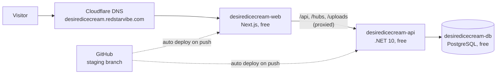

# Free Test Server on Render

Puts Desired Ice Cream online for testing at `https://desiredicecream.redstarvibe.com`, at no cost.
For an always-on production setup, use [deploy-azure.md](deploy-azure.md).

## What gets created

Everything is defined in [`render.yaml`](../render.yaml) at the repository root.

| Piece | Render service | Notes |
|---|---|---|
| Website | `desiredicecream-web` | Proxies API calls, so visitors only see one address |
| API | `desiredicecream-api` | Creates tables and starter data on first start |
| Database | `desiredicecream-db` | PostgreSQL. The API supports SQL Server and PostgreSQL |

## Free tier limits (read before you start)

| Limit | What it means for you |
|---|---|
| Services sleep after 15 minutes without visits | First visit after a break takes about 1 minute. Then it is fast |
| Free PostgreSQL expires 30 days after creation | Export or upgrade before then, or recreate it (data is lost) |
| No persistent disk | Product images uploaded in admin are lost when the API restarts or redeploys. Seeded images are fine |
| 750 free instance hours per month | Enough for testing, since sleeping services do not count |

## Steps

### 1. Create a Render account

Go to https://render.com and sign up with GitHub. No card is needed for the free plan.

### 2. Create everything from the Blueprint

1. In Render: **New → Blueprint**.
2. Connect the GitHub repository `aarvitechai/IceCreem` (allow Render access if asked).
3. Branch: `staging`. Render finds `render.yaml`.
4. It asks for **`Seed__DefaultPassword`**: enter a strong password (8+ characters, one capital letter, one number). Save it, this is the first admin password.
5. Click **Apply**. The first build takes about 10 minutes.

### 3. Check the API address

Open the `desiredicecream-api` service. Its URL should be `https://desiredicecream-api.onrender.com`.
If Render gave a different URL, open `desiredicecream-web` → **Environment**, set `API_INTERNAL_URL` to the real API URL, and click **Save, rebuild and deploy**.

Test: open `https://desiredicecream-api.onrender.com/health/ready`. It should say `Healthy`.

### 4. Connect the domain in Cloudflare

Render shows the domain under `desiredicecream-web` → **Settings → Custom Domains** with the value to point at.

In Cloudflare, **redstarvibe.com → DNS → Records → Add record**:

| Type | Name | Target | Proxy status |
|---|---|---|---|
| CNAME | `desiredicecream` | `desiredicecream-web.onrender.com` | **DNS only** (grey cloud) |

Keep the grey cloud. Render issues the HTTPS certificate itself. Then click **Verify** in Render.
After a few minutes `https://desiredicecream.redstarvibe.com` opens with a lock icon.

> If a CNAME for `desiredicecream` already exists (for example one pointing to a Cloudflare Tunnel), edit it instead of adding a second one.

### 5. First login

Open `https://desiredicecream.redstarvibe.com/login`:

| Field | Value |
|---|---|
| Email | `superadmin@icecream.local` |
| Password | the `Seed__DefaultPassword` from step 2 |

Then follow Part 5 of the Azure guide: create your own super admin and switch off the starter users.

## Updating

Every push to the `staging` branch redeploys both services automatically.
Watch progress in Render → service → **Events** and **Logs**.

## Troubleshooting

| Problem | Fix |
|---|---|
| Site takes a minute to open | Normal on the free plan after 15 idle minutes |
| Website shows "Something went wrong" | API is waking up or the URL in `API_INTERNAL_URL` is wrong (step 3) |
| API logs show a database error on start | Wait until `desiredicecream-db` is **Available**, then **Manual Deploy → Deploy latest commit** on the API |
| Domain stuck on "Verifying" | Make sure the Cloudflare record is grey cloud (DNS only) and points to the web service |
| Logged out on every refresh | Use the `https://` address |
